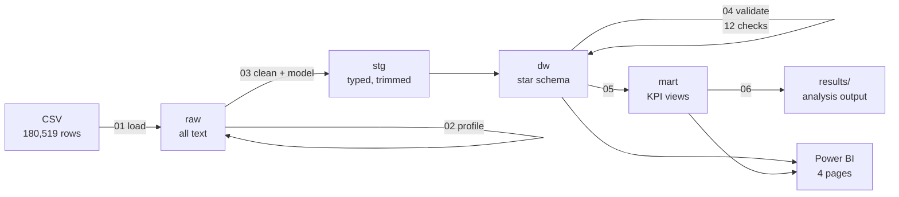
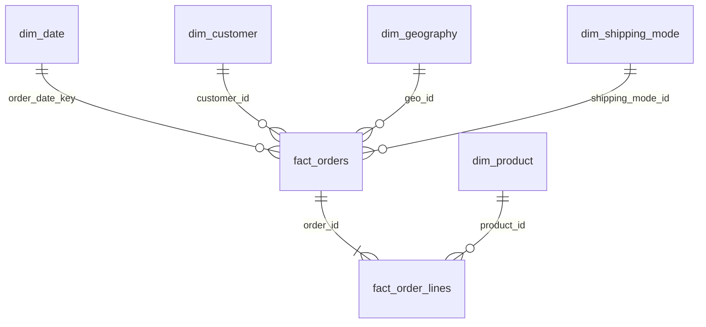
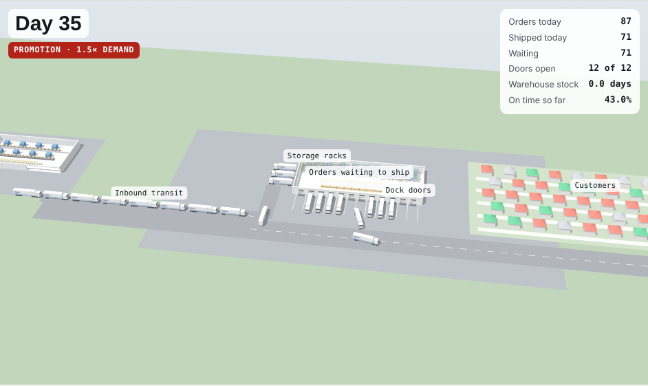

# Supply Chain Delivery Risk: why DataCo misses its delivery promise

**SQL (PostgreSQL) · Power BI · End-to-end supply chain simulation (Python SimPy, JavaScript, Three.js) · Monte Carlo · Supply chain analytics**

An end-to-end analysis of 180,519 order lines (65,752 orders, Jan 2015 – Jan 2018) from a global sporting-goods retailer. I built a cleaned star-schema warehouse in PostgreSQL, tested the usual explanations for late delivery one by one, and modelled how changing delivery promises would change on-time performance. A calibrated digital twin of the fulfilment flow then stress-tests promotional demand shocks and the responses to them. The results feed a four-page Power BI dashboard (build guide: [docs/powerbi_guide.md](docs/powerbi_guide.md)).

> **Headline:** 57.3% of shipped orders arrive later than promised. The cause is not market, customer segment or demand volume. It is the delivery promise set for each shipping mode. First Class misses its 1-day promise on 100% of orders, and Second Class is no faster than Standard Class.

Every number below comes from [results/06_analysis_output.txt](results/06_analysis_output.txt); [docs/results_placeholders.md](docs/results_placeholders.md) maps each one to its query.

<!--  -->

---

## 1. Business problem

DataCo sells sporting goods, apparel and outdoor equipment in five markets (Africa, Europe, LATAM, Pacific Asia, USCA) and offers four shipping modes, each with a promised delivery time:

| Shipping mode | Promise |
|---|---|
| Same Day | 0 days |
| First Class | 1 day |
| Second Class | 2 days |
| Standard Class | 4 days |

Most orders arrive later than promised. Before spending money on carriers, warehouses or regional fixes, management needs to know **where the delays come from and what lever would actually fix them**.

**Questions answered**

| # | Question | Where |
|---|---|---|
| Q1 | How big is the late-delivery problem, in orders and sales? | `mart.vw_kpi_summary` |
| Q2 | Is lateness driven by market, region, customer segment, payment type, year or shipping mode? | `mart.vw_late_rate_by_dimension` |
| Q3 | For each shipping mode, how does the actual lead time compare with the promise? | `mart.vw_mode_promise_gap` |
| Q4 | What on-time rate would realistic promises give, and at what cost in extra promised days? | `mart.vw_promise_scenarios` |
| Q5 | Did a jump in order volume push up the late rate? | `mart.vw_monthly_trend` |
| Q6 | Do customers whose first order was late come back less? | `mart.vw_repeat_after_first_order` |
| Q7 | How much revenue leaks through cancelled and suspected-fraud orders? | `mart.vw_revenue_leakage_by_market` |
| Q8 | Which product categories carry the most sales in late orders? | `mart.vw_category_late_exposure` |

## 2. Data

**DataCo Smart Supply Chain for Big Data Analysis.** Constante, F., Silva, F., Pereira, A. (2019), Mendeley Data, V5, [doi:10.17632/8gx2fvg2k6.5](https://doi.org/10.17632/8gx2fvg2k6.5), licensed CC BY 4.0. Also on [Kaggle](https://www.kaggle.com/datasets/shashwatwork/dataco-smart-supply-chain-for-big-data-analysis).

One flat CSV, 53 columns, one row per order line. The raw file is not stored in this repo; see [data/README.md](data/README.md).

## 3. Approach



1. **Profile before cleaning** ([02_profile_raw.sql](sql/02_profile_raw.sql)). Every cleaning decision is backed by a profiling query:
   - Six column pairs turned out to be duplicates (e.g. `Benefit per order` = `Order Profit Per Order`). One of each pair kept.
   - Shipping mode, lead time and delivery status never vary within an order, so delivery is an **order-level** event while sales are line-level. That gives two fact tables.
   - The source `Late_delivery_risk` flag marks never-shipped (cancelled) orders as "not late", which flatters the KPI. I recomputed `is_late` and left it blank for cancelled orders.
   - Personal data (names, e-mail, street) and empty columns (`Product Description` 100% empty, `Order Zipcode` 86% empty) dropped.
2. **Star schema** ([03_build_warehouse.sql](sql/03_build_warehouse.sql)): `fact_orders` (65,752 rows) and `fact_order_lines` (180,519), plus date, customer, geography, shipping-mode and product dimensions, with primary and foreign keys enforced.
3. **Automated validation** ([04_validate_warehouse.sql](sql/04_validate_warehouse.sql)): 12 reconciliation checks (row counts, sales and profit totals, flag logic, key integrity), each PASS/FAIL.
4. **Hypothesis-driven analysis** ([05_kpi_views.sql](sql/05_kpi_views.sql), [06_business_analysis.sql](sql/06_business_analysis.sql)). Each candidate driver is tested on the same metric (late rate of shipped orders), so the drivers can be ruled out against each other. SQL techniques: CTEs, window functions (`RANK`, `LAG`, `LEAD`, `ROW_NUMBER`, running and rolling sums), `PERCENTILE_CONT`, `FILTER` aggregates, `GENERATE_SERIES` scenario grids.
5. **Digital twin** ([simulation/](simulation)): a SimPy discrete-event model of order-to-delivery, calibrated on 12 months of real orders, validated against history and covered by extreme-condition tests. Used to test responses to promotional demand shocks with paired comparisons (section 5).
6. **Power BI** ([docs/powerbi_guide.md](docs/powerbi_guide.md)): Import model on the star schema, 28 DAX measures (time intelligence, `CROSSFILTER`, a what-if parameter). Headline cards are reconciled to the SQL output before any visual is built.

### Data model



## 4. Findings

**1. Late delivery is the norm, not the exception.**
57.3% of 62,897 shipped orders arrived later than promised, and those orders carry $18.1M of net sales (57.1% of shipped sales).

**2. Where and who don't explain it. How it ships does.**
Late rates barely move across markets (spread 1.1 pp) or customer segments (0.6 pp), and even across 23 regions the gap is only 7.5 pp. Across shipping modes the spread is **60.2 pp**. A regional or carrier fix would target the wrong problem.

<!--  -->

**3. Two shipping modes have promises they can't keep.**
- **First Class** promises 1 day and takes 2.0 days on average: late on 100% of orders.
- **Second Class** promises 2 days but averages 4.0 days, the same as Standard Class (4.0 days). Its late rate is 80.0%, against 39.9% for Standard.
- Together these two modes are 34.8% of shipped orders but 53.8% of late orders.

**4. Volume is not the constraint.**
From October 2017 average monthly orders rose 21.0% against the prior 12 months, while the late rate moved only from 57.1% to 57.6%. The network absorbed the extra volume without slipping further, which points away from capacity as the cause.

**5. Realistic promises would change the picture.**
Holding today's lead times fixed, setting each mode's promise to the shortest one that is met at least 75% of the time would lift network on-time delivery from 42.7% to 84.1%. The cost is 1.4 extra promised days per order on average.

<!--  -->

**6. No measurable effect on repeat purchase in this data.**
Customers whose first order was late reordered within 180 days at 56.4%, against 55.1% for on-time first orders. The dataset has no complaints, returns or reviews, so the customer cost of lateness can't be measured here. That is a gap to close, not proof that lateness is harmless.

**7. Revenue leakage is a separate, smaller issue.**
Cancelled and suspected-fraud orders account for $1.4M (4.3% of net sales), spread fairly evenly across markets.

<!--  -->

## 5. Digital twin: what happens during a promotion?

The SQL analysis explains normal operations. A promotion is different: demand rises above anything the data shows the network handling. I built a [discrete-event digital twin](simulation/README.md) of the order-to-delivery flow and checked it against history: daily volume and on-time rates match within 0.25 pp. Then I ran 14-day promotions at 1.5x and 2x demand, with dispatch capacity set to the busiest day seen (64 orders), varied from 64 to 96 in a sensitivity test.

- **A promotion turns a promise problem into a capacity problem.** A 1.5x promotion cuts on-time delivery from 43.0% to 22.8% and leaves a backlog of about 254 orders that takes about 40 days to clear. At 2x, on-time delivery falls to 2.3%.
- **Surge capacity is the strongest single response.** +50% dispatch capacity during the promotion recovers +20.2 pp at 1.5x and +27.8 pp at 2x.
- **Quoting longer delivery times on promotional orders adds to it.** Surge capacity plus 3 extra quoted days gives the best result: 59.7% at 1.5x, 53.5% at 2x.
- **Dispatching premium modes first doesn't raise the overall on-time rate.** At 1.5x the change is +0.0 pp (p = 0.81), but it protects Same Day customers (18.2% → 49.3%).

Each response was compared with "no action" over 30 paired replications. All gains are significant at p < 0.001 except premium-first at 1.5x.

### End to end: from supplier to customer

The dispatch twin assumes the warehouse always has stock. I extended it upstream ([end-to-end model](simulation/README.md#6-end-to-end-model-supplier-to-customer)) with a supplier, inbound transport and warehouse stock managed with an order-up-to policy. Units per order are calibrated from the data. Supplier capacity (1.25× normal demand), inbound lead time (5 days) and safety stock (2 days) are assumptions, varied in a sensitivity test. With unlimited supply the model reproduces the dispatch twin exactly.

| 1.5x promotion, responses added step by step | On time | Stockout days |
|---|---|---|
| No action | 22.8% | 0.0 |
| Dispatch surge +50% | 32.0% | 10.9 |
| + share the promotion plan with the supplier | 39.6% | 6.7 |
| + supplier flex capacity (1.6×) | 43.0% | 0.0 |
| + quote 3 extra days on promotion orders | 59.7% | 0.0 |

- **Fixing dispatch moves the bottleneck upstream.** The dispatch-only twin says +50% surge restores a 1.5x promotion to 43.0%. End to end it reaches only 32.0%, because the warehouse runs out of stock on about 11 of the 60 days.
- **Reacting to recent sales creates a bullwhip effect.** Under reactive planning, the warehouse's orders to the supplier vary 5.0× as much as customer demand in normal operations. Sharing the promotion plan brings that to 1.0× and cuts stockout days from 10.9 to 6.7.
- **A coordinated plan restores normal service.** Warehouse surge, a shared plan and supplier flex capacity together bring on-time delivery back to the no-promotion level. Quoting longer delivery times adds the rest.


**Try it in the browser:** a [3D supply chain twin with Monte Carlo analysis](web/README.md) runs entirely in the page. Watch goods move from the supplier's factory, along the inbound road, through the warehouse racks and dock doors, and out to customers, all driven by the simulation. It shows the spread of outcomes across hundreds of simulated years, the chance of hitting service targets or running out of stock, and how reliably each response beats doing nothing. Open `web/index.html`, or the GitHub Pages link once Pages is enabled.



There is also a Python **interactive app** (`streamlit run simulation/app.py`) for testing any promotion and response combination live:


## 6. Recommendations

1. **Fix First Class first.** It is late on almost every order and takes a fixed, predictable time, so it is the quickest win. Either promise what is delivered, or find the fixed one-day step behind it (order cut-off time, warehouse handover). That needs process timestamps this dataset doesn't have.
2. **Re-design or re-price Second Class.** Customers choosing it get no speed advantage over Standard Class. Find out whether these orders are routed through the Standard network.
3. **Set promises from the lead-time distribution, not from targets.** Use a stated on-time objective (e.g. 75% or 90%) and the scenario table to pick each mode's promise. Review it quarterly.
4. **Don't fund regional or carrier changes on this evidence.** Location differences are too small to justify them.
5. **Plan promotions with the whole chain, not just the warehouse.** Size each promotion against dispatch capacity and supply. Share the promotion plan with the supplier ahead of time, agree flex capacity, line up warehouse surge capacity, and quote longer delivery times on promotional orders. Surge capacity on its own just moves the bottleneck to stock.
6. **Collect the missing data:** carrier, warehouse and handover timestamps, plus complaints and returns. That would show *why* lead times vary and what late delivery costs in lost customers.

## 7. Limitations

- **The data looks partly simulated.** Actual lead times are spread almost uniformly (e.g. Standard Class: 2–6 days, about 20% each). Late rates are nearly identical across every non-mode dimension, and orders with status `PENDING_PAYMENT` still have delivery outcomes. The method transfers to real data; the specific numbers should not be read as industry benchmarks.
- **Last four months behave differently.** From Oct 2017 order counts rise while average order value roughly halves (Q5b), which suggests a product-mix change or partial data. Trend conclusions rest mainly on 2015 to Sep 2017.
- **"Sales in late orders" is exposure, not loss.** There is no cost, penalty or churn data to turn late delivery into lost money.
- **The promise scenarios change only the promise.** They measure how much of the problem is promise-setting. They are not a forecast of operational improvement.
- **The twin's dispatch capacity and everything upstream are assumptions** (supplier capacity, inbound lead time, safety stock). Its limitations are listed in [simulation/README.md](simulation/README.md#5-limitations).
- Country and city names are in Spanish (e.g. *Estados Unidos*), as in the source.

## 8. Reproduce it

Full Windows walkthrough: **[docs/windows_setup.md](docs/windows_setup.md)**. In short:

```powershell
# from the repo root, with PostgreSQL 16 installed and the CSV in data\
powershell -ExecutionPolicy Bypass -File .\run_all.ps1
```

Then build the dashboard with **[docs/powerbi_guide.md](docs/powerbi_guide.md)** and run the twin:

```powershell
pip install -r simulation/requirements.txt
python simulation/run_experiments.py
streamlit run simulation/app.py   # interactive twin
```

## 9. Repository structure

```
├── sql/
│   ├── 00_setup_database.sql      create database + schemas
│   ├── 01_load_raw.sql            load CSV into raw (all text)
│   ├── 02_profile_raw.sql         profiling queries behind each cleaning decision
│   ├── 03_build_warehouse.sql     staging + star schema with keys
│   ├── 04_validate_warehouse.sql  12 PASS/FAIL reconciliation checks
│   ├── 05_kpi_views.sql           KPI views (mart schema)
│   ├── 06_business_analysis.sql   Q1–Q8 business questions
│   └── 07_simulation_inputs.sql   calibration data for the digital twin
├── simulation/                    digital twin (SimPy): model, app, tests, experiments, results
├── web/                           browser twin: 3D supply chain + Monte Carlo (one HTML file, no install)
├── results/                       query outputs (the evidence for the findings)
├── powerbi/                       .pbix dashboard
├── docs/
│   ├── windows_setup.md
│   ├── powerbi_guide.md
│   ├── results_placeholders.md
│   ├── index.html                 browser twin, served by GitHub Pages
│   └── images/                    dashboard screenshots
├── data/                          put the CSV here (git-ignored)
└── run_all.ps1                    runs 00–07 in order
```
