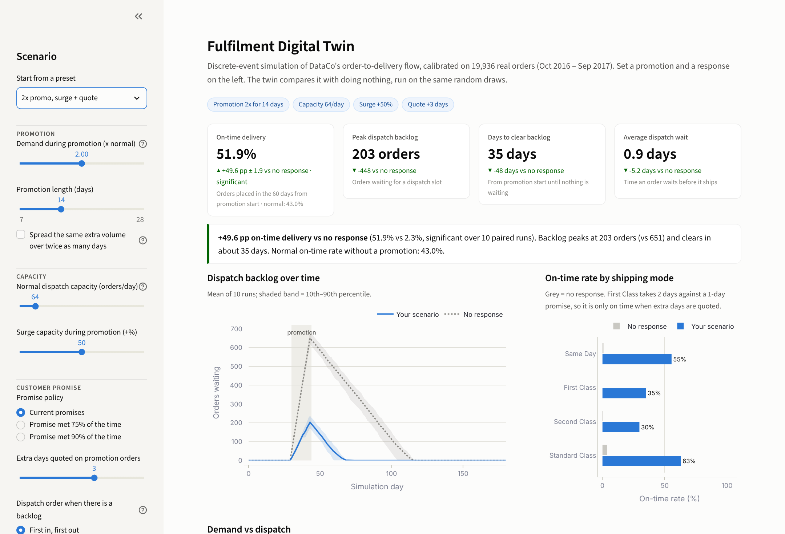
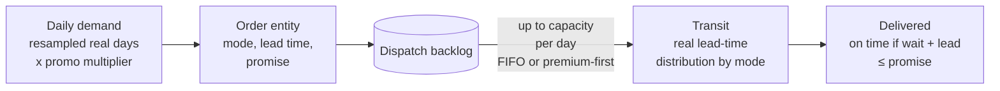
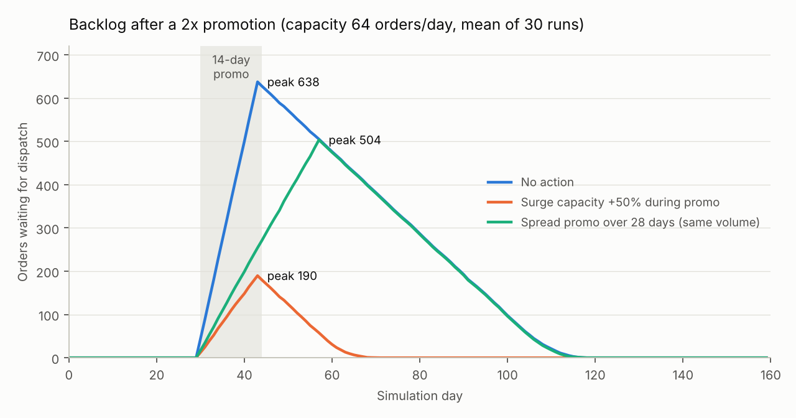
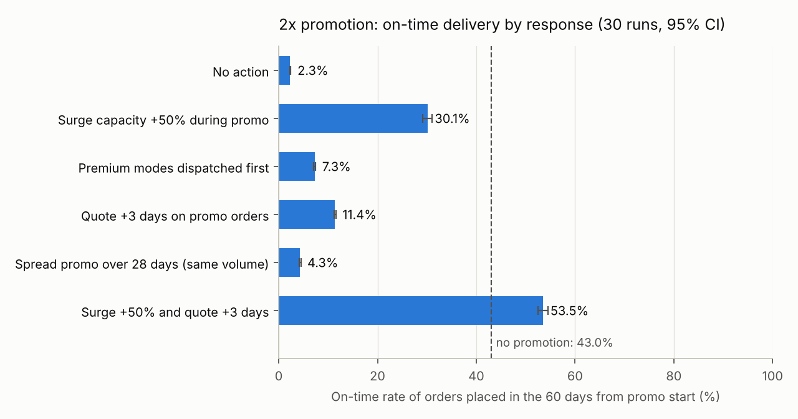
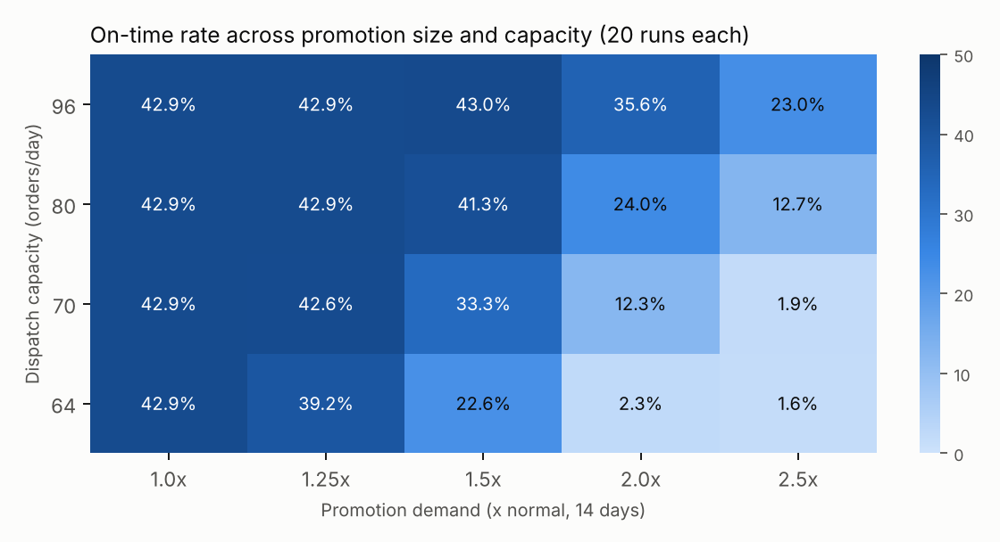
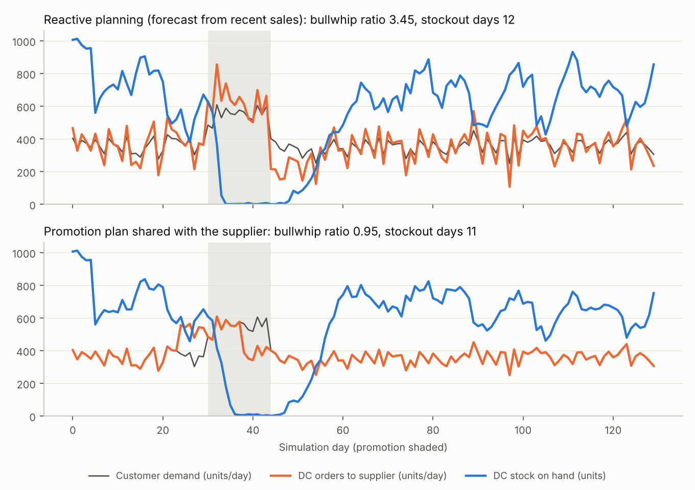
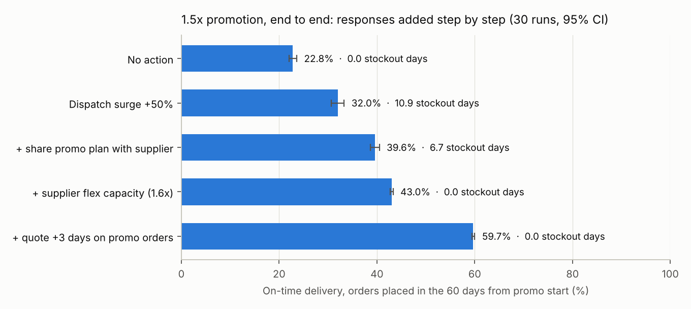

# Supply chain digital twin: stress-testing promotions

A discrete-event simulation (Python, SimPy) of DataCo's order-to-delivery flow, calibrated on 12 months of real orders. The SQL analysis explains today's late deliveries. The twin asks the forward-looking question:

> **What happens to delivery performance when a promotion pushes demand above what the network has handled, and which response protects it best?**

This extends my undergraduate thesis, which simulated mitigation strategies for promotion-driven demand shocks in digital retail supply chains (Vensim). The twin applies the same discipline in a discrete-event model on real data: scenario analysis, sensitivity analysis, extreme-condition tests and paired statistical comparison.

## Interactive app

A browser version with a full Monte Carlo view (distributions, risk probabilities, convergence) lives in [`web/`](../web/README.md). It needs no install. The Streamlit app below runs the Python model itself.

```powershell
pip install -r simulation/requirements.txt
streamlit run simulation/app.py            # opens http://localhost:8501
```

Pick a preset or set your own promotion (size, length, spread), capacity (normal and surge), customer promise (policy, extra quoted days) and dispatch rule. The app runs the SimPy model live and compares your scenario with "no response" on the same random draws (paired runs). It shows:
- on-time delivery, peak backlog, recovery time and dispatch wait, each with its difference vs no response
- a one-line verdict, including whether the difference is statistically significant
- backlog over time with a 10th–90th percentile band, on-time rate by shipping mode, and demand vs dispatch capacity
- per-run results as a CSV download, the saved 30-run study, and the model's assumptions and validation



## 1. Model



| Element | How it is modelled | Source |
|---|---|---|
| Demand | Each simulated day resamples one real day's shipped-order count, then applies the promotion multiplier | 365 days, Oct-2016 to Sep-2017 (`inputs/daily_demand.csv`) |
| Shipping mode | Drawn from the real mode mix (Same Day 5.5%, First 15.3%, Second 19.3%, Standard 59.9%) | `inputs/lead_time_distribution.csv` |
| Lead time | Drawn from the real distribution for the order's mode | same file |
| Promise | Today's promise per mode (0 / 1 / 2 / 4 days) unless a scenario changes it | same file |
| Dispatch | Once a day the warehouse releases up to *capacity* orders from the backlog | **Assumption**, see below |
| On time | (dispatch day − order day) + lead time ≤ promise | same rule as the SQL analysis |

Each order is a SimPy process (entity), so the model tracks every order's wait, mode and outcome. Separate random-number streams for demand, mode and lead time give **common random numbers**: two responses run with the same seed face the same demand and the same lead-time draws, so differences come from the policy, not from noise.

**Why resample real days instead of assuming Poisson arrivals:** daily demand in the data has a variance of 12.5 against a mean of 54.6. Poisson arrivals would give a variance of about 54.6. Resampling keeps the real, much steadier pattern.

### The key assumption: dispatch capacity

The data has no warehouse or carrier timestamps, so capacity can't be measured directly. What the data does show is that the busiest day of the calibration year (**64 shipped orders**) was handled with no slowdown. The twin sets capacity at that level, the only level known to work. Experiment E3 varies it from 64 to 96 orders a day, so no conclusion depends on this single number.

## 2. Validation

`run_validation.py` runs the baseline (no promotion, today's promises) for 30 simulated years and compares it with history. Full table: [`results/validation.csv`](results/validation.csv).

| Metric | History | Twin (mean of 30) |
|---|---|---|
| Daily orders: mean | 54.6 | 54.6 |
| Daily orders: std dev | 3.53 | 3.51 |
| On-time rate, all modes | 42.9% | 42.9% |
| On-time rate, Second Class | 20.3% | 20.2% |
| On-time rate, Standard Class | 60.5% | 60.5% |
| Dispatch wait | 0 days | 0 days |

Every metric is within 0.25 percentage points. Because the twin is calibrated on this same period, this is **verification** (the model does what it was built to do), not proof that it predicts the future.

`tests/test_model.py` adds 11 automated checks, including extreme-condition tests: zero demand creates no orders; zero capacity dispatches nothing; unlimited capacity reproduces the historical on-time rate; orders are conserved; more capacity never lowers on-time delivery.

## 3. Experiments and results

All results: [`results/`](results). 30 replications per scenario (20 for the sensitivity grid). ± values are 95% confidence intervals.

### E1. Promise policy, normal demand

| Policy | Promise (Same Day / First / Second / Standard) | On-time rate | Extra promised days per order |
|---|---|---|---|
| Current promises | 0 / 1 / 2 / 4 days | 42.9% ± 0.2 | 0 |
| Promise met 75% of the time | 1 / 2 / 5 / 5 days | 84.3% ± 0.1 | 1.39 |
| Promise met 90% of the time | 1 / 2 / 6 / 6 days | 100.0% | 2.18 |

This matches the SQL scenario analysis (Q4c: 42.7% → 84.1% on the full dataset). Under normal demand the promise is the lever, not capacity.

### E2. A 14-day promotion, and six possible responses

On-time rate of orders placed from promotion start to 60 days later. Without a promotion it is **43.0%**. Each response is compared with "No action" using a paired t-test on the same 30 seeds.

| Response | 1.5x promotion | vs no action | 2x promotion | vs no action |
|---|---|---|---|---|
| No action | 22.8% | — | 2.3% | — |
| Surge capacity +50% during promo | 43.0% | **+20.2 pp** | 30.1% | **+27.8 pp** |
| Premium modes dispatched first | 22.8% | +0.0 pp (p = 0.81) | 7.3% | +5.0 pp |
| Quote +3 days on promo orders | 39.6% | +16.9 pp | 11.4% | +9.1 pp |
| Spread promo over 28 days (same volume) | 31.3% | +8.5 pp | 4.3% | +2.0 pp |
| Surge +50% and quote +3 days | 59.7% | +36.9 pp | 53.5% | +51.2 pp |

All differences are significant at p < 0.001, except premium-first at 1.5x. Full table with backlog and wait times: [`results/e2_shock_responses.csv`](results/e2_shock_responses.csv).





### E3. Sensitivity: promotion size × capacity



## 4. What the twin shows

1. **A promotion turns a promise problem into a capacity problem.** At 64 orders/day, a 1.5x promotion halves on-time delivery (43.0% → 22.8%) and leaves a backlog of about 254 orders that takes about 40 days to clear. At 2x, on-time delivery collapses to 2.3% and recovery takes about 81 days. The backlog outlasts the promotion by months because spare capacity on a normal day is only about 9 orders.
2. **Capacity is the strongest single lever.** A 50% surge during the promotion fully protects a 1.5x promotion (back to 43.0%) and recovers 27.8 pp at 2x.
3. **Honest promises are the second lever, and they stack.** Quoting 3 extra days on promotional orders recovers 16.9 pp at 1.5x. It works less well at 2x (+9.1 pp), because the average wait (6 days) exceeds the buffer. Combined with surge capacity it gives the best result in both cases. The combined result can beat the no-promotion baseline because the extra quoted days also absorb normal lead-time variation on those orders.
4. **Dispatch priority reallocates lateness rather than reducing it.** Premium-first leaves the overall on-time rate unchanged at 1.5x. It does protect Same Day customers (on-time 18.2% → 49.3%), so it is a customer-experience lever, not a capacity fix.
5. **Spreading the promotion helps only when capacity is near demand.** At 1.5x, spreading the same extra volume over 28 days recovers 8.5 pp. At 2x the stretched promotion still exceeds capacity every day, and the gain is only 2.0 pp.
6. **Plan headroom before planning promotions.** About 25% headroom (80 orders/day) absorbs a 1.5x promotion (41.3%). A 2x promotion needs 96 or more orders/day, and even then reaches only 35.6%.

**Recommendation:** treat promotion planning and fulfilment capacity as one decision. Before a promotion, size it against available dispatch capacity, line up surge capacity (overtime, temporary staff, a second shift), and quote longer delivery times on promotional orders. Use premium-first dispatch only to protect Same Day customers.

## 5. Limitations

- **Capacity is an assumption.** The data shows 64 orders/day was handled. It doesn't show the true ceiling. E3 shows how the conclusions shift if the ceiling is higher.
- **Single dispatch stage.** Warehouse picking, packing and carrier handover are combined into one daily capacity. The data has no timestamps to separate them.
- **Lead times don't stretch under load.** Transit times are drawn from the normal-period distribution. A congested carrier network could slow them too, so promotion results are likely optimistic.
- **Demand doesn't react.** Customers don't cancel or switch modes when delivery slows.
- **The source data looks partly simulated** (see the main README). The twin's method transfers to real data; its numbers are not benchmarks.

## 6. End-to-end model: supplier to customer

`twin/chain.py` extends the twin upstream. Each simulated day:

1. The supplier ships up to its daily capacity from its order backlog. Goods reach the warehouse after the inbound lead time.
2. The warehouse receives today's arrivals.
3. Customer orders arrive: the same demand, mode and lead-time draws as the dispatch twin, plus units per order drawn from the real distribution (1–24 units, mean 6.5; `inputs/units_per_order.csv`).
4. Dispatch ships up to capacity, and only while the units are in stock. An order that can't be filled blocks the queue behind it.
5. The warehouse reorders with an order-up-to policy: target = expected demand over (lead time + 1 day) + safety stock; order = target − inventory position. Expected demand comes from exponential smoothing of recent sales (reactive) or from the shared promotion plan (promo-aware).

| Input | Value | Source |
|---|---|---|
| Demand, mode mix, lead times, promises | as in section 1 | data |
| Units per order | 1–24, mean 6.5 (352.7 units/day) | data |
| Supplier capacity | 1.25 × mean daily units | **assumption** |
| Inbound lead time | 5 days | **assumption** |
| Safety stock | 2 days of mean demand | **assumption** |
| Planning | reactive (α = 0.2) or promo-aware | **assumption / lever** |

**Checks** (`tests/test_chain.py`, 14 tests):
- With unlimited supply the model reproduces the SimPy dispatch twin **exactly**, run for run (same seeds, 8 scenario/seed combinations).
- Units are conserved day by day: stock change = received − shipped.
- Default upstream assumptions never cause a stockout in normal operations, so the historical validation still holds.
- Zero supplier capacity stops dispatch once stock runs out. More supplier capacity never lowers on-time delivery.

**Results** (`run_chain_experiments.py`; 30 runs each, paired t-tests):

| Normal operations | On time | Stockout days | Bullwhip ratio |
|---|---|---|---|
| Unlimited supply | 42.9% | 0 | – |
| Reactive planning | 42.9% | 0 | 5.01 |
| Promotion plan shared | 42.9% | 0 | 1.00 |

| Response (added step by step) | 1.5x: on time | stockout days | 2x: on time | stockout days |
|---|---|---|---|---|
| No action | 22.8% | 0.0 | 2.3% | 0.0 |
| Dispatch surge +50% | 32.0% | 10.9 | 4.9% | 12.2 |
| + share promo plan with supplier | 39.6% | 6.7 | 9.5% | 10.8 |
| + supplier flex capacity (1.6×) | 43.0% | 0.0 | 28.9% | 2.0 |
| + quote +3 days on promo orders | 59.7% | 0.0 | 51.9% | 2.0 |

Sensitivity (1.5x promotion, dispatch surge, reactive): on-time delivery ranges from 17.1% (10-day lead time, 0.5 days of safety stock) to 42.5% (2-day lead time, 4 days of safety stock). Full grid: [`results/c3_upstream_sensitivity.csv`](results/c3_upstream_sensitivity.csv).





**What it adds:** a dispatch-only model overstates what warehouse surge capacity achieves. Once dispatch keeps up, stock becomes the constraint. The supplier can't follow a demand spike it only sees through the warehouse's reactive orders (the bullwhip effect). Promotions need a coordinated plan: share the plan, agree flex capacity, surge the warehouse, quote realistic delivery times.

## 7. Run it

```powershell
# from the repo root (Python 3.10+)
pip install -r simulation/requirements.txt
python -m pytest simulation/tests          # 11 checks
python simulation/run_validation.py        # ~10 s
python simulation/run_experiments.py       # ~2-3 min, writes simulation/results/
python simulation/run_chain_experiments.py # end-to-end model, ~40 s
streamlit run simulation/app.py            # interactive app
```

The calibration CSVs in `inputs/` are committed, so the twin runs without the database. To regenerate them from PostgreSQL: `psql -U postgres -d dataco -f sql/07_simulation_inputs.sql`.

```
simulation/
├── inputs/                  calibration data exported by sql/07
├── twin/
│   ├── inputs.py            loads calibration
│   ├── model.py             SimPy model: scenarios, order entities, dispatcher
│   ├── chain.py             end-to-end model: supplier, inbound, warehouse stock, dispatch
│   └── experiment.py        replications, confidence intervals, paired t-test
├── tests/test_model.py      extreme-condition and logic tests
├── run_validation.py        twin vs history
├── run_experiments.py       E1-E3 + charts
├── app.py                   interactive Streamlit front end
└── results/                 CSV tables and PNG charts
```
