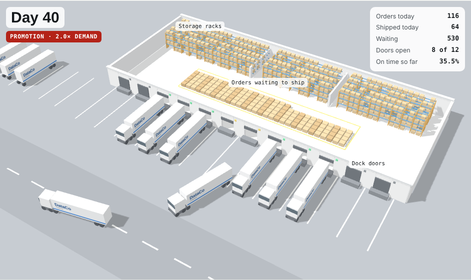

# Browser twin with Monte Carlo

The fulfilment digital twin, running entirely in the browser: no Python, nothing to install. It has two parts on one page, driven by the same scenario settings: a 3D dispatch yard that plays out one simulated year, and a Monte Carlo study across hundreds of years.



## Live dispatch yard (3D)

A Three.js scene animates one replication of the simulation, day by day:

| What you see | What it means in the model |
|---|---|
| Boxes on the yellow staging lane | Orders waiting for dispatch (1 box = 4 orders); the pile grows when daily orders exceed capacity |
| Lit dock doors (12 in total) | That day's dispatch capacity at 8 orders per truck: 64 orders/day opens 8 doors, and surge capacity opens more |
| Trucks backing in and pulling out | Orders shipped that day, one truck per 8 orders |
| Door lamps | Green = truck loading, amber = door open and idle |
| Panel and backlog strip | Orders placed and shipped today, orders waiting, doors open, on-time rate so far, and the backlog path for the whole year |

Play, pause, jump to any day, replay the promotion, or change speed (1×–30×, 1× = 4 seconds per day). Drag to rotate and scroll to zoom. The yard replays the same random draws as the first Monte Carlo run, so the backlog strip matches the model exactly. If a browser has WebGL turned off, the page shows a note and the Monte Carlo study still works.

## Monte Carlo study


**Open it:** double-click `web/index.html`. It's one self-contained file and needs an internet connection only for the chart library and fonts. Or publish it with GitHub Pages (below).

Choose a promotion (size, length, spread), capacity (normal and surge), customer promise (policy, extra quoted days) and dispatch rule, or start from a preset. For each change the page runs a **Monte Carlo** study:

- 100 to 1,000 **simulated years** per scenario. Each one plays out every order through dispatch and transit with its own random demand days and lead times.
- Your scenario and "no response" run **paired**: the same random draws for both, so each run is a fair head-to-head.
- 300 simulated years per scenario take about 3 seconds.

It shows:

| Output | What it answers |
|---|---|
| Outcome tiles with 90% ranges | Average on-time delivery, peak backlog, recovery time and dispatch wait, plus the range that 90% of runs fall in |
| Verdict | Gain vs doing nothing, the share of runs where your scenario wins, and statistical significance (paired test) |
| On-time distribution | Histogram of on-time delivery across runs for both scenarios, against your target |
| Gain run by run | Distribution of the paired difference: how reliably a response pays off |
| Risk table | Chance of reaching the on-time target, of the backlog exceeding a limit, of clearing within N days, and of falling well below normal. Thresholds are editable. |
| Backlog fan chart | Median backlog per day with the band covering the middle 80% of runs |
| On time by shipping mode | Where the gains land |
| Convergence | Running average with its 95% confidence band, showing whether enough runs were made |

## How it relates to the Python model

`twin.js` is a JavaScript port of `simulation/twin/model.py`: same flow, same rules, same calibration data (`calibration.js` is generated from `simulation/inputs/*.csv`). The random-number generator differs, so individual runs differ, but the distributions agree.

`check_model.js` checks this. It re-runs the 12 promotion experiments and the baseline with 500 runs each and compares them with the Python results:

```
node web/check_model.js      # All 37 checks passed
```

## Files

| File | Role |
|---|---|
| `app.html` | Page source (UI, charts) |
| `twin.js` | Simulation engine (batch or one day at a time) + Monte Carlo + statistics (browser and Node) |
| `yard.js` | 3D dispatch yard (Three.js), driven by `twin.js` day by day |
| `calibration.js` | Generated calibration data |
| `build.py` | Regenerates `calibration.js` and builds the one-file `index.html` (also copied to `docs/index.html`) |
| `check_model.js` | Cross-check against the Python model |

After editing `app.html` or `twin.js`, run `python web/build.py`.

## Publish it as a public link (GitHub Pages)

1. On GitHub: **Settings → Pages → Build and deployment**.
2. Source: **Deploy from a branch**. Branch: **main**, folder: **/docs**. Save.
3. After a minute or two the twin is live at `https://daniel766hi.github.io/supply-chain-delivery-risk/`.
