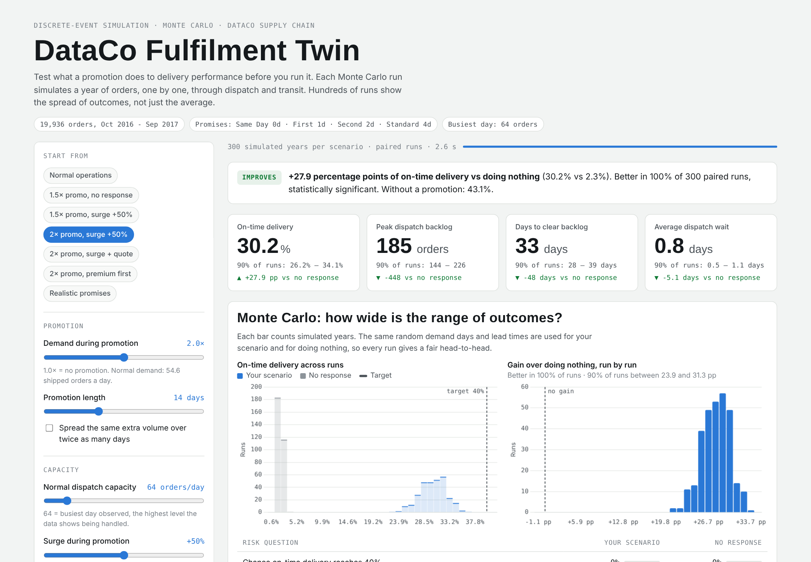

# Browser twin with Monte Carlo

The fulfilment digital twin, running entirely in the browser: no Python, nothing to install.



**Open it:** double-click `web/index.html`. It's one self-contained file and needs an internet connection only for the chart library and fonts. Or publish it with GitHub Pages (below).

## What it does

Choose a promotion (size, length, spread), capacity (normal and surge), customer promise (policy, extra quoted days) and dispatch rule, or start from a preset. For each change the page runs a **Monte Carlo** study:

- 100 to 1,000 **simulated years** per scenario. Each one plays out every order through dispatch and transit with its own random demand days and lead times.
- Your scenario and "no response" run **paired**: the same random draws for both, so each run is a fair head-to-head.
- 300 simulated years per scenario take about 3 seconds.

It shows:

| Output | What it answers |
|---|---|
| Outcome tiles with 90% ranges | Average on-time delivery, peak backlog, recovery time and dispatch wait, plus the range that 90% of runs fall in |
| Verdict | Gain vs doing nothing, the share of runs where your scenario wins, and statistical significance (paired test) |
| On-time distribution | Histogram of on-time delivery across runs for both scenarios, against your target |
| Gain run by run | Distribution of the paired difference: how reliably a response pays off |
| Risk table | Chance of reaching the on-time target, of the backlog exceeding a limit, of clearing within N days, and of falling well below normal. Thresholds are editable. |
| Backlog fan chart | Median backlog per day with the band covering the middle 80% of runs |
| On time by shipping mode | Where the gains land |
| Convergence | Running average with its 95% confidence band, showing whether enough runs were made |

## How it relates to the Python model

`twin.js` is a JavaScript port of `simulation/twin/model.py`: same flow, same rules, same calibration data (`calibration.js` is generated from `simulation/inputs/*.csv`). The random-number generator differs, so individual runs differ, but the distributions agree.

`check_model.js` checks this. It re-runs the 12 promotion experiments and the baseline with 500 runs each and compares them with the Python results:

```
node web/check_model.js      # All 37 checks passed
```

## Files

| File | Role |
|---|---|
| `app.html` | Page source (UI, charts) |
| `twin.js` | Simulation engine + Monte Carlo + statistics (browser and Node) |
| `calibration.js` | Generated calibration data |
| `build.py` | Regenerates `calibration.js` and builds the one-file `index.html` (also copied to `docs/index.html`) |
| `check_model.js` | Cross-check against the Python model |

After editing `app.html` or `twin.js`, run `python web/build.py`.

## Publish it as a public link (GitHub Pages)

1. On GitHub: **Settings → Pages → Build and deployment**.
2. Source: **Deploy from a branch**. Branch: **main**, folder: **/docs**. Save.
3. After a minute or two the twin is live at `https://daniel766hi.github.io/supply-chain-delivery-risk/`.
